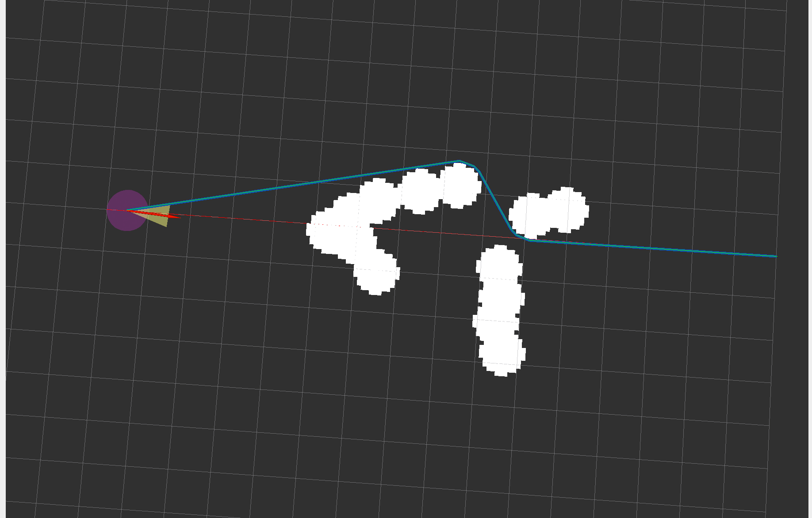

# TopoPRM-2D-ROS2

[](https://docs.ros.org/en/humble/)
[](LICENSE)
[](CMakeLists.txt)

面向地面移动机器人的 ROS 2 二维局部轨迹规划工程。TopoPRM 在二维占据地图中搜索多条拓扑不同的避障路线，发布所有有效候选，并将其中长度最短的一条作为最优规划轨迹。若 TopoPRM 随机采样未找到有效路线，则使用膨胀栅格上的 A* 搜索进行一次兜底。

ROS 2 节点提供 RViz 交互输入与规划结果可视化。GitHub 项目目录名为 `TopoPRM-2D-ROS2`，ROS 包名为 `topoprm_2d`，可执行文件为 `motion_plan`。

## 规划效果



## 核心功能

- **二维地图**：原始占据层与圆形膨胀层，局部地图随当前车体位置重建。
- **单圆碰撞模型**：以车辆参考点为中心进行圆形膨胀与碰撞检查。
- **TopoPRM 前端**：构建拓扑路线图，对候选路线执行缩短、同伦类别筛选和占据栅格碰撞复核；为交互运行限制采样时间和候选数。
- **最优路线输出**：候选路线按长度排序，最短的无碰撞路线作为 `/visual_local_trajectory`。
- **RViz 可视化**：`/trajectories` 显示所有有效候选路线，绿色 `/visual_local_trajectory` 显示最优路线；同时显示参考路径和障碍物。
- **失败处理与计时**：TopoPRM 无有效路线时使用膨胀栅格 A* 兜底；一次规划未生成轨迹时自动重试一次，并在 ROS 日志中打印每次耗时。

当前仓库提供规划与可视化节点、Launch 一键启动文件及预置 `rviz.rviz` 配置，不包含小车动力学仿真或轨迹跟踪控制器。

## 编译与运行

### 环境与依赖

已在 ROS 2 Humble 环境完成编译验证。其他 ROS 2 发行版尚未验证。

需要 CMake 3.22 或更新版本、支持 C++17 的编译器、Eigen3，以及以下 ROS 2 依赖：

`ament_cmake`、`rclcpp`、`nav_msgs`、`geometry_msgs`、`sensor_msgs`、`visualization_msgs`、`tf2`、`tf2_ros`。

一键启动还需要 `launch`、`launch_ros` 和 `rviz2`。

### 编译

在包含本包的工作空间或本项目根目录执行：

```bash
source /opt/ros/humble/setup.bash
colcon build --packages-select topoprm_2d
source install/setup.bash
```

### 一键启动（推荐）

在完成编译的目录中执行：

```bash
source /opt/ros/humble/setup.bash
source install/setup.bash
ros2 launch topoprm_2d demo.launch.py
```

该命令同时启动 `motion_plan` 规划节点和 RViz，并自动加载随包安装的 `rviz.rviz`。配置已设置 **Fixed Frame = map** 和规划显示项，无需手动添加；按 `Ctrl+C` 结束本次启动的两个进程。

新增或修改 Launch 文件、`rviz.rviz` 后，请重新执行上述编译命令并加载环境。加载安装环境后，启动命令不依赖当前目录。运行 RViz 需要可用的图形显示环境；在 Docker 内启动时需配置显示转发。

也可指定自己的 RViz 配置：

```bash
ros2 launch topoprm_2d demo.launch.py rviz_config:=/absolute/path/to/custom.rviz
```

### 分别启动（可选）

调试时可在两个终端分别启动；每个终端都先加载 ROS 2 和工作空间环境：

```bash
source /opt/ros/humble/setup.bash
source install/setup.bash
```

终端 1：

```bash
ros2 run topoprm_2d motion_plan
```

终端 2：

```bash
rviz2 -d "$(ros2 pkg prefix --share topoprm_2d)/rviz.rviz"
```

预置配置中的主要显示项如下：

| RViz 显示类型 | 话题 | 内容 |
| --- | --- | --- |
| Grid | — | 平面网格 |
| Path | `/visual_global_path` | 全局参考路径 |
| MarkerArray | `/trajectories` | 所有有效 TopoPRM 候选路线 |
| Path | `/visual_local_trajectory` | 长度最短的有效路线（最优路线） |
| PointCloud2 | `/visual_obstacles` | 原始障碍物 |
| PointCloud2 | `/visual_local_obstacles` | 局部地图膨胀结果 |

### RViz 交互流程

工具用途以当前代码为准：本项目将 **2D Goal Pose 用于添加障碍物**。

1. 使用 **Publish Point**（`/clicked_point`）依次添加参考路径点，至少添加两个不同位置的点。
2. 使用 **2D Goal Pose**（`/goal_pose`）添加障碍物；可添加多个，也可以先测试无障碍路径。
3. 使用 **2D Pose Estimate**（`/initialpose`）设置机器人起点与航向；已有参考路径时会触发规划。
4. 在 RViz 中查看规划结果。设置当前位置后，继续添加路径点或障碍物也会触发重规划。

参考路径点击会追加点，障碍物点击也会追加障碍物。当前未提供清空话题，需要重新开始场景时可重启节点。

## 单圆车体碰撞模型

规划器以车辆参考点为圆心，将 `vehicle.circle_radius` 作为障碍膨胀半径进行碰撞检查。地图只处理 XY 平面，不建立 Z 栅格，也不计算 ESDF；输入障碍物只使用 XY 坐标。

```text
collision_center = vehicle_reference_position
collision_radius = vehicle.circle_radius
```

圆半径直接作为占据膨胀半径。栅格膨胀按栅格方形间的最小距离计算，以覆盖离散误差；地图外及非有限输入按非空闲区域处理。实际使用时应根据车体外形和所需安全余量设置参数。默认值用于演示，并不对应特定车型。

### TopoPRM 拓扑搜索

TopoPRM 从当前起点到参考路径终点构建拓扑路线图，搜索并筛选多条路线。所有候选都会再通过膨胀占据地图的离散碰撞检查；剩余路线按长度排序，最短路线作为最优结果。算法输出的是几何路径，不显式搜索速度状态。

## ROS 2 参数

节点启动时读取单圆碰撞半径：

| 参数 | 默认值 | 含义 |
| --- | --- | --- |
| `vehicle.circle_radius` | 0.4 m | 车辆参考点周围的单圆碰撞半径 |

示例：

```bash
ros2 run topoprm_2d motion_plan --ros-args \
  -p vehicle.circle_radius:=0.5
```

地图尺寸、分辨率和 TopoPRM 的采样上限仍在源码中配置。

## 话题接口

节点名为 `topoprm_2d_interactive_node`。下表使用默认命名空间下的话题名。

| 方向 | 话题 | 消息类型 | 用途 |
| --- | --- | --- | --- |
| 订阅 | `/clicked_point` | `geometry_msgs/msg/PointStamped` | 追加参考路径点 |
| 订阅 | `/goal_pose` | `geometry_msgs/msg/PoseStamped` | 追加障碍物，使用位置 XY |
| 订阅 | `/initialpose` | `geometry_msgs/msg/PoseWithCovarianceStamped` | 更新车体起点、航向并触发重规划 |
| 发布 | `/visual_global_path` | `nav_msgs/msg/Path` | 参考路径 |
| 发布 | `/trajectories` | `visualization_msgs/msg/MarkerArray` | 所有有效 TopoPRM 候选路线 |
| 发布 | `/visual_local_trajectory` | `nav_msgs/msg/Path` | 最短有效路线，即最优路线 |
| 发布 | `/visual_obstacles` | `sensor_msgs/msg/PointCloud2` | 原始障碍物 |
| 发布 | `/visual_local_obstacles` | `sensor_msgs/msg/PointCloud2` | 膨胀障碍物 |

`/rviz_input_global_path` 和 `/rviz_input_obstacles` 的订阅创建代码目前被注释，不能直接作为已启用的数据入口。

## 目录结构

```text
.
├── CMakeLists.txt
├── package.xml
├── launch/demo.launch.py                 # 一键启动规划节点与 RViz
├── rviz.rviz                             # RViz 预置配置
├── include/trajectory_obstacles_publisher.h
├── src/trajectory_publisher.cpp           # ROS2 交互、参数、发布及路径离散
└── planner/
    ├── GridMap2D/                         # 二维地图与单圆碰撞查询
    ├── path_searching/                    # TopoPRM 拓扑路线搜索
    └── plan_manage/                       # 规划流程与 ROS 接口
```


## 参考与致谢

- [HKUST-Aerial-Robotics/Fast-Planner](https://github.com/HKUST-Aerial-Robotics/Fast-Planner)：感谢 Fast-Planner 团队开源分享，TopoPRM 前端的实现参考其拓扑路线搜索。
- [ZJU-FAST-Lab/ego-planner](https://github.com/ZJU-FAST-Lab/ego-planner)：原始 EGO-Planner 算法。
- [JackJu-HIT/Ego-Planner-2D-ROS2](https://github.com/JackJu-HIT/Ego-Planner-2D-ROS2)：本项目改造所基于的二维 ROS 2 工程。
-  [JackJu-HIT/SCAN-Planner-Pure-ROS2](https://github.com/JackJu-HIT/SCAN-Planner-Pure-ROS2)：局部占据地图与沿航向前后偏移查询的参考实现。

本项目由 Two-Circle-EGO-Planner-2D-ROS2 改造而来，前端拓扑搜索参考并移植自 `standalone_planner/topoprm_2d`。用于二次开发或论文时，请注明所使用的仓库地址与版本，并保留上游署名。

## 作者与交流

作者：**鞠柏贤**。

- 微信公众号：**机器人规划与控制研究所**。[相关技术文章](https://mp.weixin.qq.com/s/MLHtW-vXelH-ljNn2hDdLA)
- Bilibili：**机器人算法研究所**。[原项目演示视频](https://www.bilibili.com/video/BV11RUfB8ELb/)

以上链接沿用基础项目资料，不代表本项目的性能验证记录。

## 许可证

项目主体采用 [Apache License 2.0](LICENSE)。TopoPRM 源文件保留 Fast-Planner 的 LGPL-3.0-or-later 版权与许可声明；使用、修改和分发时请同时遵守相应文件中的上游许可证要求。

*文档更新：2026-11-01*
